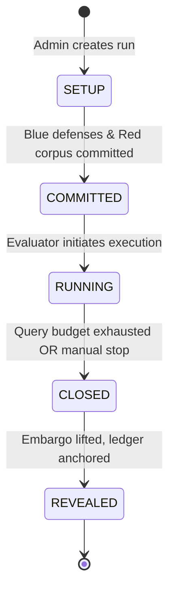

# Bayora Zone Specifications, Lifecycle & Trust Assumptions

> **Document Version:** 1.0 (Phase 0 Deliverable)  
> **Status:** RATIFIED  
> **PRD References:** §16.1, §18, §19, SEC-001 through SEC-014, FR-001, FR-002, FR-005

---

## 1. Five-Zone Detailed Specifications

Every component of Bayora operates within one of five isolated security domains. The specifications below define the operational and isolation parameters for each zone on the host platform (**Oracle Cloud Always Free VM.Standard.A1.Flex — 2 ARM OCPUs / 12 GB RAM / 200 GB Boot Volume / Ubuntu 24.04 LTS / ARM64**).

```
+=============================================================================+
| CORE 0 (Dedicated Physical Core): Model Zone (llama.cpp, single thread)     |
+-----------------------------------------------------------------------------+
| CORE 1 (Shared via cgroup v2 CFS): Control + Red (gVisor) + Blue + Audit    |
+=============================================================================+
```

### 1.1 Zone 1: Red Team Zone (Untrusted / Adversary)
* **Purpose:** Hosts the adversarial evaluation client, attack generator, and adversarial corpus runner.
* **Trust Level:** **Zero Trust (Untrusted).** Treated as potentially malicious code seeking to escape, probe defenses, or steal model weights.
* **Assets Housed:** Red attack prompts, generation scripts, client evaluation state.
* **Permitted Communications:** Egress HTTP to Control Zone (`http://gateway:8000/v1/eval/query`) only.
* **Forbidden Operations:** Direct network access to Blue, Model, or Audit zones; raw host filesystem access; access to host networking; access to external internet during active evaluation runs.
* **Container Runtime:** **MANDATORY gVisor (`runsc`)** per PRD SEC-007. Intercepts and virtualizes all Linux syscalls in user space.
* **CPU & Resource Allocation:**
  - `cpuset`: Core 1 (shared with Control, Blue, and Audit via cgroup v2 CFS quotas).
  - CPU limit: 0.25 vCPU quota (`cpu.max: 25000 100000`).
  - Memory limit: 1 GB RAM + 0 MB swap (`memory.swap.max = 0`).
  - Read-Only root filesystem: `read_only: true` with ephemeral `tmpfs` at `/tmp` (max 64 MB, `noexec`, `nosuid`, `nodev`).
  - Capabilities dropped: `ALL` (no `NET_RAW`, no `SYS_ADMIN`, no `SYS_PTRACE`).

### 1.2 Zone 2: Blue Team Zone (Proprietary Defenses)
* **Purpose:** Hosts proprietary safety classifiers, prompt injection detectors, heuristic filters, and output leak scanners.
* **Trust Level:** **High (Confidential Intellectual Property).** Defenses must remain sealed from Red discovery.
* **Assets Housed:** Blue defense heuristics, regex patterns, classifier weights, detection thresholds.
* **Permitted Communications:** Ingress/Egress mTLS HTTP with Control Zone Gateway only.
* **Forbidden Operations:** Direct communication with Red Team or Model Server; state retention across distinct evaluations; persistent writes to disk.
* **Container Runtime:** Hardened `runc`.
* **CPU & Resource Allocation:**
  - `cpuset`: Core 1.
  - CPU limit: 0.25 vCPU quota (`cpu.max: 25000 100000`).
  - Memory limit: 2 GB RAM + 0 MB swap.
  - Read-Only root filesystem: `read_only: true`.
  - Capabilities dropped: `ALL`.

### 1.3 Zone 3: Model Zone (Target LLM Engine)
* **Purpose:** Hosts the local target model server executing CPU inference via `llama.cpp`.
* **Trust Level:** **High (Confidential Model Weights & State).** Must be protected from weight extraction, cache poisoning, and side-channel snooping.
* **Assets Housed:** Model weights (`Qwen2.5-1.5B-Instruct-Q4_K_M.gguf`, pinned SHA-256), inference execution engine.
* **Permitted Communications:** Ingress/Egress mTLS HTTP with Control Zone Gateway only.
* **Forbidden Operations:** External internet access; KV cache sharing across requests; prompt caching (`--no-mmap`, `--cache-prompt false`); non-deterministic multi-tenant batching.
* **Container Runtime:** Hardened `runc` with custom seccomp profile (experimental gVisor trial time-boxed to 1–2h in Phase 1 per D-CONF-8; fallback to hardened `runc` per R-20).
* **CPU & Resource Allocation:**
  - `cpuset`: **Core 0 (Strictly Dedicated Physical Core).** Never colocated with Red, Blue, or Control processes to eliminate microarchitectural cache interference and timing side channels.
  - CPU limit: 1.0 dedicated physical OCPU (`cpu.max: max`).
  - Memory limit: 4 GB RAM + 0 MB swap (Qwen2.5-1.5B Q4_K_M footprint is ~1.5 GB).
  - Storage: Read-only bind mount for `models/` weights directory.

### 1.4 Zone 4: Control Zone (Evaluation Gateway & Policy Engine)
* **Purpose:** Orchestrates the evaluation lifecycle, enforces OPA policy, mediates cross-zone requests, manages secrets, and pushes events to the audit ledger.
* **Trust Level:** **Trusted Computing Base (TCB).** Root of enforcement within the sandbox.
* **Assets Housed:** Gateway orchestration logic, OPA Rego policies, OpenBao secrets, `step-ca` PKI root, SQLite run metadata.
* **Permitted Communications:**
  - Multi-homed across all internal bridge networks (Red-Net, Blue-Net, Model-Net, Audit-Net).
  - External ingress from Evaluator Admin port.
* **Forbidden Operations:** Bypassing OPA policy checks; logging unredacted sensitive attack payloads in plaintext; exposing raw model or blue filter endpoints.
* **Container Runtime:** Hardened `runc`.
* **CPU & Resource Allocation:**
  - `cpuset`: Core 1 (shared with Red, Blue, and Audit via CFS quotas).
  - CPU limit: 0.5 vCPU quota (`cpu.max: 50000 100000`).
  - Memory limit: 2 GB RAM.

### 1.5 Zone 5: Audit Zone (Immutable Ledger & Telemetry)
* **Purpose:** Receives, cryptographically signs (Ed25519), and records all evaluation events in an append-only hash chain; captures eBPF kernel telemetry; publishes Merkle roots to external anchors.
* **Trust Level:** **Integrity Anchor.** Write-once, read-by-auditor-only.
* **Assets Housed:** Private Ed25519 signing key, SHA-256 block ledger, Merkle trees, Falco eBPF security event logs.
* **Permitted Communications:**
  - Ingress IPC / socket from Zone 4 Gateway.
  - Egress HTTPS to External Anchor (GitHub Private Repo / Rekor).
* **Forbidden Operations:** Mutating previously written blocks; executing untrusted scripts; accepting queries from Red or Blue.
* **Container Runtime:** Hardened `runc`.
* **CPU & Resource Allocation:**
  - `cpuset`: Core 1.
  - CPU limit: 0.25 vCPU quota (`cpu.max: 25000 100000`).
  - Memory limit: 1 GB RAM.
  - Storage: Append-only persistent volume.

---

## 2. Evaluation Run Lifecycle State Machine

Every evaluation session progresses through a strict five-state deterministic lifecycle. State transitions are governed by OPA policy and recorded in the audit ledger. Backward transitions are impossible.



### 2.1 Lifecycle State Descriptions

| State | Permitted Actions | Prohibited Actions | Transition Guard / Criteria |
|---|---|---|---|
| **SETUP** | - Register run metadata<br/>- Upload initial configuration<br/>- Verify container health | - Executing model inference<br/>- Red submitting test prompts | Run parameters, model SHA-256, and budgets configured. |
| **COMMITTED** | - Cryptographic hashing of Red attack suite and Blue defense filters<br/>- Ledger records initial genesis state | - Modifying defense heuristics<br/>- Modifying attack corpus<br/>- Modifying OPA policies | Ed25519 signatures generated for all input manifests and committed to ledger. |
| **RUNNING** | - Red submits evaluation queries ($Q \le 200$)<br/>- Gateway invokes Blue filters and Model<br/>- Uniform refusals and completions returned<br/>- Audit ledger records events | - Direct inter-zone communication<br/>- Changing run parameters or budget<br/>- Inspecting intermediate audit ledger | Run query count $< Q$, time $< T_{max}$, and kill-switch not triggered. |
| **CLOSED** | - Inference pipeline halted immediately<br/>- Final ledger block computed and signed<br/>- Merkle root published to External Trust Anchor | - Any further model queries<br/>- Red or Blue state modification | Query budget reached, time expired, or operator calls `/v1/eval/runs/{id}/close`. |
| **REVEALED** | - Embargo lifted<br/>- Full evaluation report generated<br/>- Ledger proofs made accessible for independent verification | - Altering historical run logs<br/>- Deleting audit chain | Merkle root confirmed anchored externally; evaluator signs release authorization. |

---

## 3. Embargo Policy & Anti-Collusion Rules

To ensure fair and uncompromised competitive evaluation between Red and Blue teams:
1. **Pre-Run Embargo:** Red cannot inspect Blue defense source code, classifiers, or rules. Blue cannot inspect Red attack corpora prior to run commitment.
2. **In-Flight Embargo:** During `RUNNING` state, Red receives only uniform refusal tokens or sanitized model completions. Red never receives classifier confidence scores, execution timestamps, or filter identifiers.
3. **Post-Run Embargo:** Unredacted logs containing raw zero-day exploits or sensitive prompt extractions remain encrypted under `age` public keys until designated publication schedules (State: `REVEALED`).

---

## 4. Trust Assumptions (TA-1 through TA-6)

Security guarantees in Bayora rely on the following explicit trust assumptions (PRD §18):

* **TA-1 (Host OS & Hypervisor Integrity):** The underlying Linux kernel (Ubuntu 24.04 LTS), the Oracle Cloud hypervisor, and ARM64 hardware (Ampere Altra) are assumed to be uncompromised and operating correctly. We defend against container breakout, not cloud hypervisor exploits.
* **TA-2 (TCB Integrity):** The Evaluation Gateway, OPA policy engine, OpenBao secrets manager, and `step-ca` CA running in the Control Zone (Zone 4) are correctly implemented and constitute the trusted computing base.
* **TA-3 (Audit Ledger Non-Equivocation):** Once a block hash or Merkle root is committed and published to the external anchor (GitHub/Rekor), the audit history cannot be silently rewritten or bifurcated.
* **TA-4 (Deterministic Hardware Isolation):** Physical CPU pinning (`cpuset`) on non-hyperthreaded Ampere Altra ARM64 cores provides deterministic computational isolation, preventing simultaneous multithreading (SMT) cache leakage between the Model and other zones.
* **TA-5 (Evaluator Authority):** The human operator / evaluator acting with admin credentials is trusted not to collude with the Red or Blue teams during active runs.
* **TA-6 (Cryptographic Primitives):** Standard cryptographic algorithms (SHA-256, Ed25519, AES-256-GCM, TLS 1.3) are computationally sound and resist practical cryptanalysis.
